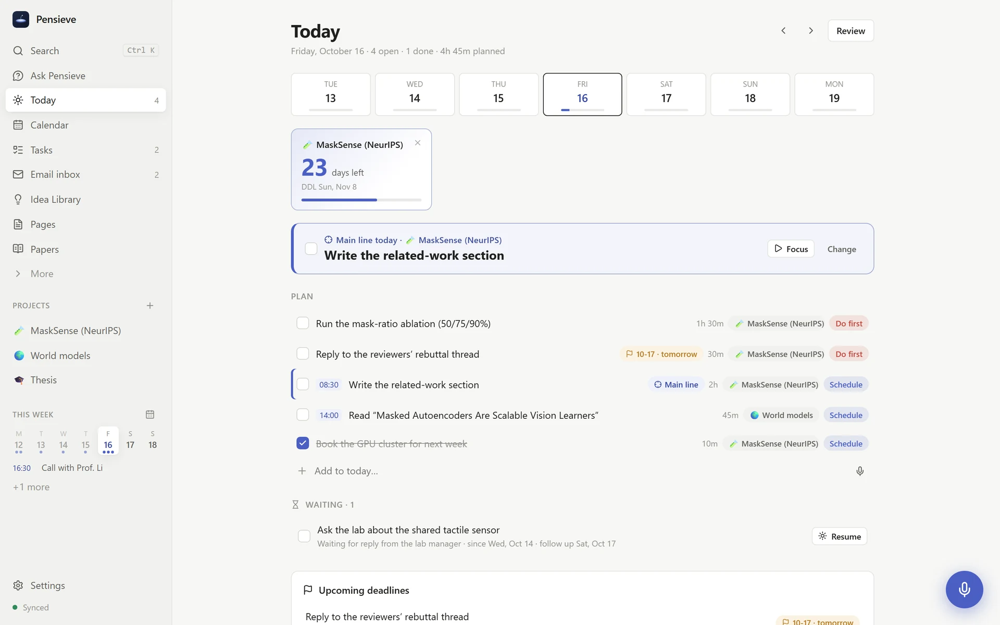
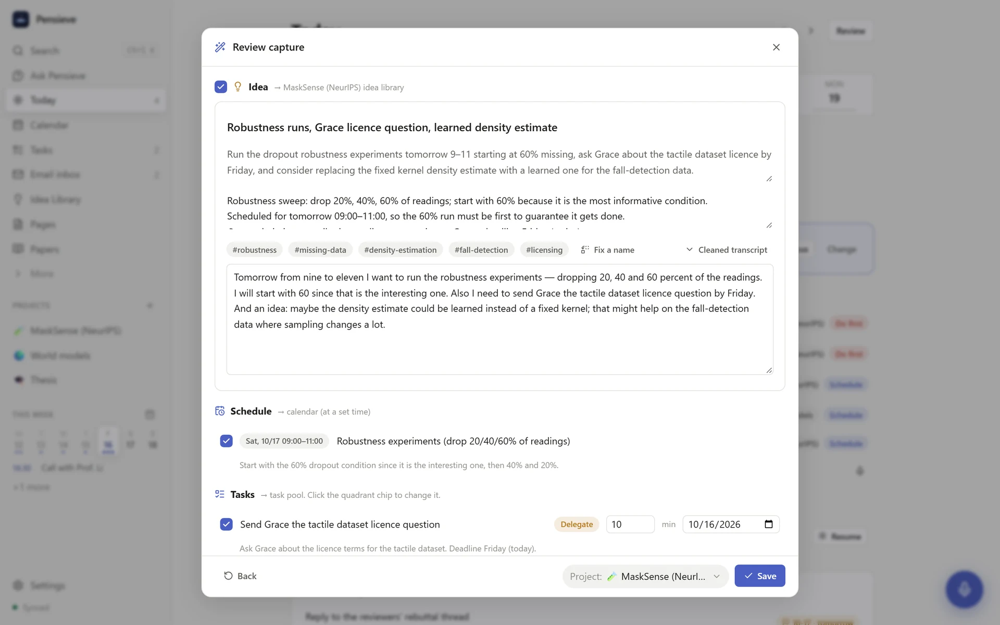
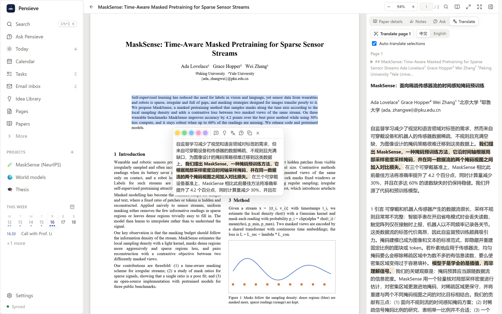
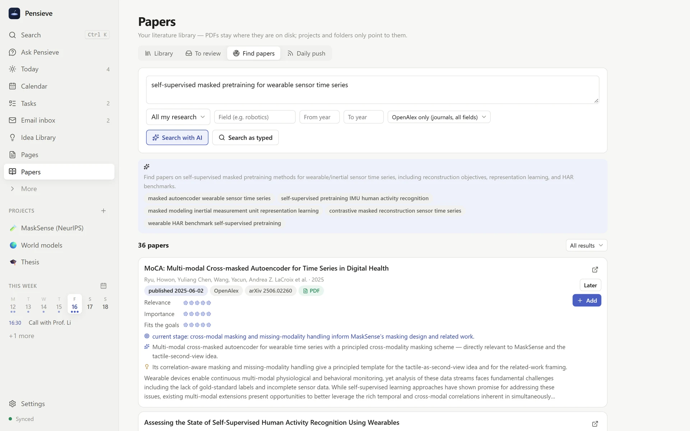
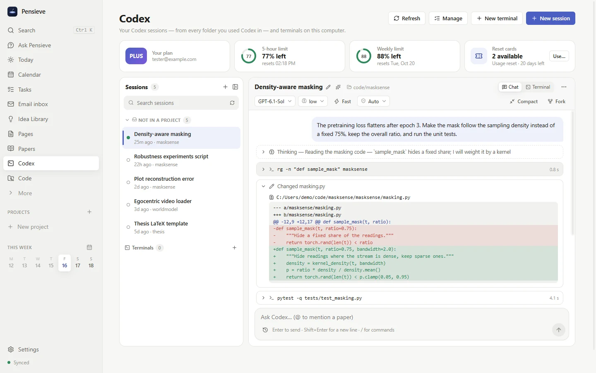

<h1 align="center">Pensieve</h1>

<b>The AI research notebook that keeps up with you.</b> 
Think out loud and get organized · read papers in your own language · never miss new work · plan a day you can actually do.

> *"I use the Pensieve. One simply siphons the excess thoughts from one's mind, pours them into the basin, and examines them at one's leisure."*
> — Albus Dumbledore, *Harry Potter and the Goblet of Fire*

<b>Free</b> · <b>Works locally</b> · <b>Collects no data</b> · <b>No account</b> 
Windows · macOS (Apple Silicon & Intel) · Linux · Android · iPhone & iPad

<a href="https://photonghost308.github.io/pensieve-app/"><b>🌐 Website</b></a> &nbsp;·&nbsp; <a href="https://github.com/PhotonGhost308/pensieve-app/releases/latest"><b>⬇️ Download the latest version</b></a>

## Why Pensieve

- 🎙 **Think out loud, get organized.** Ramble for a minute — Pensieve turns it into an idea, to-dos and calendar entries, each in its place. With the cursor in a text box or a page, it is plain dictation: a small waveform, and your words are tidied and typed right there (Ctrl+Shift+Space, again to finish, Esc to cancel).
- 📄 **Read papers in your own language.** Select a passage or translate a page: the translation follows the paper's paragraphs and puts the key sentences in **bold**.
- 🔎 **Never miss new work.** AI searches arXiv and OpenAlex, rates every paper against *your* project and brings the newest ones every morning.
- 🗓 **A day you can actually do.** Appointments stay fixed, work fits around them, reminders reach your phone.
- 📬 **Email that tells you what it needs** — to-dos, deadlines, meetings and reply drafts, pulled out for you.
- 💻 **Codex, Git and terminals** right next to your notes (desktop).
- 🌏 **English and 中文**, light and dark, on every device — always in sync.

| | |
|---|---|
|  |  |
|  |  |

## Free, local, private

- **Free.** Pensieve costs nothing. You pay your AI provider only for what you use — or run a free local model with Ollama.
- **Works locally.** Your computer is the hub: your notes live there, every paired phone or laptop keeps a full copy that works offline, and sync goes straight between your own devices — or, if you like, through your own Jianguoyun (坚果云) WebDAV account.
- **Collects no data.** No account, no Pensieve cloud, no analytics, no tracking — nothing is ever sent to us.
- **Your AI, your key.** AI requests go directly from your computer to the service you choose (DeepSeek, SiliconFlow, OpenAI, Qwen, Kimi, GLM, Ollama…). Your key is stored encrypted on your computer.

## Get started in five minutes

1. **[Download Pensieve](https://photonghost308.github.io/pensieve-app/#download)** and install it on the computer you keep running — it is the hub your phone syncs with.
2. Add an AI model key in **Settings → AI models**.
3. Pair your phone in **Settings → Sync → Pair a phone** (enter the address and the 6-digit code on the phone).
4. Press the round mic — or **Ctrl/⌘+Shift+Space** — and say what's on your mind.

First start: Windows SmartScreen → *More info → Run anyway*. macOS → *System Settings → Privacy & Security → Open Anyway* (the app is not notarized yet). Linux → `chmod +x` the AppImage, or `sudo apt install ./Pensieve-*.deb`. iPhone / iPad (iOS 15+) → download the IPA and install it with Sideloadly or AltStore ([step by step](https://photonghost308.github.io/pensieve-app/#ios-install)).

## Designer

Pensieve is designed by **Tianyi Xu** — homepage: [photontec.github.io](https://photontec.github.io/#about-me).

Questions, ideas, bugs: [open an issue](https://github.com/PhotonGhost308/pensieve-app/issues).
